# 냥미터기 (Cat Meter)

함께 출퇴근하는 차에서, **차가 누가 어디서 타고 내렸는지 알아보고** 그 사람이 탄 구간의 기름값·충전비만 **운전자와 똑같이 나눠 자동으로 정산**하는 Pleos Connect 앱입니다. 함께 달린 길은 옛 돈 단위 '냥'으로 세고, 도착하면 '냥' 하고 우는 고양이가 영수증(냥수증)을 건넵니다.

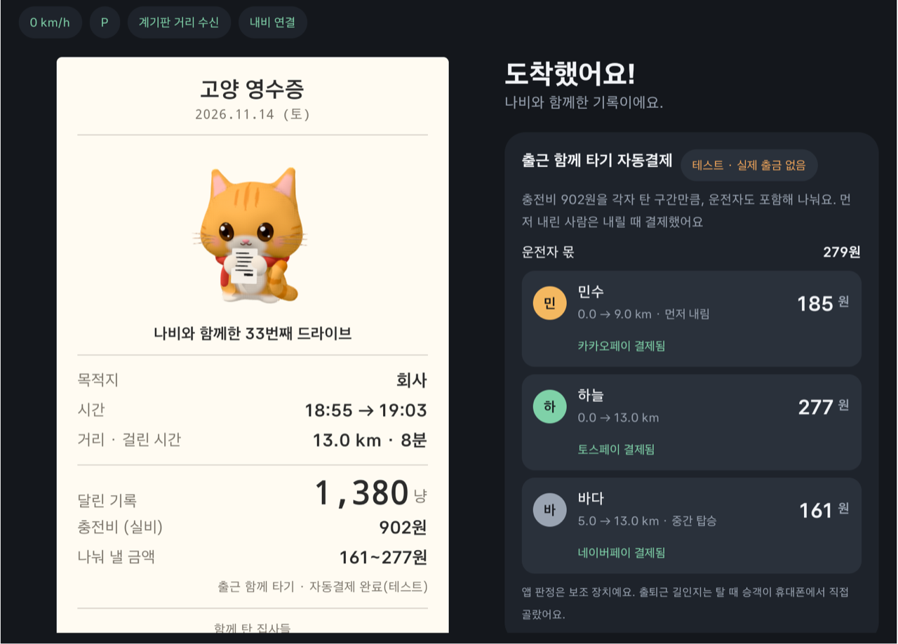

- 현대자동차그룹 Pleos 차량용 앱 개발 공모전 출품작입니다.
- 이 문서는 기획서 [`docs/application/2026_11_10_app_intro.md`](docs/application/2026_11_10_app_intro.md)를 바탕으로 썼습니다. 근거 자료, 수치 계산, 출처는 기획서에 있습니다.
- 결제는 **테스트 결제**이며 실제 출금은 없습니다. 센서와 화면 동작은 Pleos Connect 에뮬레이터(v2.1.0)에서 확인했고, 실차에서는 확인하지 못했습니다.

## 목차

- [왜 만들었나](#왜-만들었나)
- [화면으로 보는 한 번의 출근길](#화면으로-보는-한-번의-출근길)
- [주요 기능](#주요-기능)
- [금액을 나누는 방법](#금액을-나누는-방법)
- [언제 정산이 켜지나](#언제-정산이-켜지나)
- [안전 설계](#안전-설계)
- [사용한 차량 데이터](#사용한-차량-데이터)
- [실행](#실행)
- [구조](#구조)
- [한계와 남은 일](#한계와-남은-일)
- [문서](#문서)

## 왜 만들었나

대상은 같은 회사나 같은 방향으로 출퇴근하면서 한 차를 함께 타는 지인들입니다. 카풀 앱으로 만난 사이가 아니라서, 지금은 송금 앱의 정산하기를 쓰거나 "한 달에 얼마" 하고 말로 약속하거나 아무것도 하지 않습니다.

커뮤니티와 기사에서 지인끼리 타는 차의 비용 문제를 다룬 글 20여 건의 원문을 읽었습니다 (2026-11-14). 설문이 아니라 사연이라 얼마나 흔한지를 보여 주는 숫자는 아닙니다. 인용과 주소는 기획서 2번과 [`2026_11_14_app_intro_pain_points_draft.md`](docs/application/2026_11_14_app_intro_pain_points_draft.md)에 있습니다.

| 누구 | 겪는 문제 | 냥미터기가 하는 일 |
|---|---|---|
| 운전자 | 돈 얘기를 못 꺼내고 떠안는다 | 도착하면 실비가 자동으로 정산된다. 운전자는 아무 말도, 아무 조작도 하지 않는다 |
| 운전자 | 받을 금액을 정해야 하는데 기준이 없다 | 기준을 하나로 정한다. 직접 든 비용만, 운전자도 같은 몫을 낸다. 금액은 차가 계산한다 |
| 운전자 | 돈을 받아도 되는 운행인지 모른다 | 출퇴근 조건을 통과한 운행에서만 정산이 켜진다 |
| 동승자 | 얼마를 줘야 맞는지 기준이 없다 | 차가 실제 연비와 달린 거리로 계산한 금액을 운전자와 똑같이 나눠 보여 준다 |
| 동승자 | 실제 기름값을 몰라 부르는 대로 낸다 | 냥수증에 거리와 실비, 각자 낸 금액이 남는다 |

**왜 차량 앱인가.** 위 문제는 모두 "실제로 누가 얼마나 탔고, 실제로 얼마가 들었는가"를 아무도 모르기 때문에 생깁니다. 휴대폰 송금 앱은 총액을 사람 수로 나눌 뿐이지만, 차는 이미 답을 알고 있습니다.

| 알아야 하는 것 | 차가 가진 데이터 |
|---|---|
| 실제로 든 기름값·충전비 | 계기판 누적 거리, 차량 연비·전비 |
| 누가 어느 자리에 탔고 언제 내렸나 | 좌석 점유, 안전벨트 착용, 문 열림 |
| 탄 구간의 길이 | 탑승·하차 지점의 계기판 거리 |
| 출퇴근 길이 맞나 | 내비에 등록된 집·회사, 출발·도착 위치 |
| 도착했나 | P단, 내비 안내 종료 |

**왜 '냥'이고 고양이인가.** 옛 우리 돈의 단위가 '냥(兩)'이고, '냥'은 고양이 울음소리이기도 합니다. 냥은 실제로 오가는 돈이 아닙니다. 주고받는 돈은 실비뿐이고, 냥은 함께 달린 만큼 쌓이는 기록입니다. 돈 이야기는 실비라도 어색해서, 정산이 청구서가 아니라 함께 탄 기록으로 보이게 하려고 고양이가 영수증을 건넵니다.

## 화면으로 보는 한 번의 출근길

아래 화면은 2026-11-14(토)에 Pleos Connect 에뮬레이터에서 한 번의 이동을 실제로 돌려 캡처한 것입니다. 좌석·문·기어·계기판 거리는 Virtual Console로 넣었고, 승객 휴대폰 화면은 탑승 등록 웹 페이지를 휴대폰 크기 브라우저로 연 것입니다. 에뮬레이터 차량이 전비를 주지 않아 전기차 기본값(5.0 km/kWh, 347원/kWh)으로 계산됐습니다. 토요일이라 시연용 출퇴근 판정(debug 빌드 전용, [실행](#실행) 참고)을 켜고 정산했습니다.

이동: 집 → 회사 13km. 민수(조수석)와 하늘(뒷좌석 왼쪽)이 처음부터 타고, 바다(뒷좌석 오른쪽)가 5km 지점에서 타고, 민수가 9km 지점에서 먼저 내립니다.

### 1. 출발 전: 오늘의 고양이와 예상 실비

내비에서 목적지를 찍으면 예상 실비와 정산할 수 있는 이동인지를 미리 보여 줍니다. 고양이 이름·털 색·소품을 함께 고릅니다. 캡처한 날이 토요일이라 "토·일·공휴일에는 정산할 수 없어요"가 보입니다.

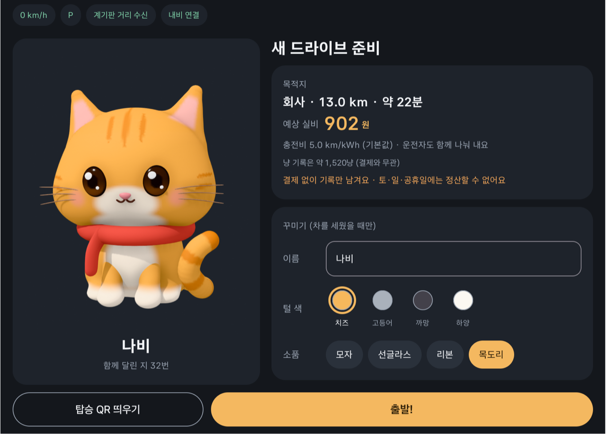

### 2. 앉으면 뜨는 탑승 QR

동승석에 사람이 앉으면 차가 서 있는 동안 탑승 QR이 자동으로 뜹니다. 두 명 이상이 함께 앉으면 QR 하나를 띄우고 각자 휴대폰에서 자리를 고르게 합니다. 좌석 배치도의 점선 칸이 "앉았지만 아직 등록하지 않은 자리"입니다.

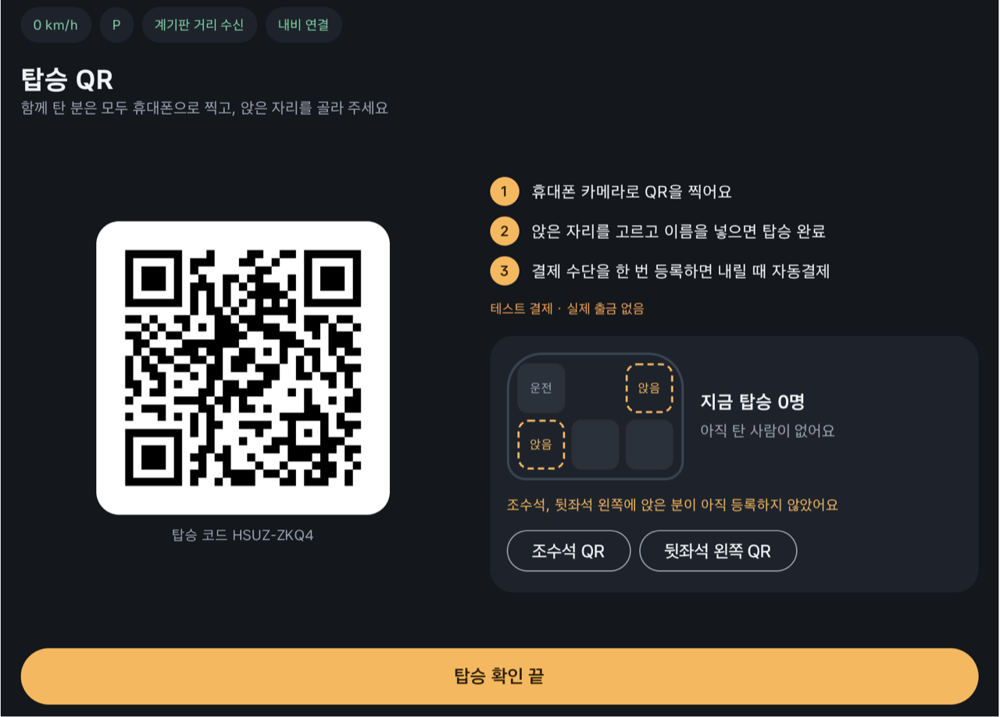

### 3. 승객 휴대폰: 자리 고르기 → 탑승 → 결제 수단 한 번 등록

QR을 찍으면 차 좌석 배치도가 나옵니다. **사람이 앉아 있고 아직 아무도 고르지 않은 자리만** 누를 수 있습니다. 이름을 넣고 "지금 출근·퇴근하는 길이에요"를 고른 뒤 결제 수단을 한 번 등록하면 끝입니다.

<p>
  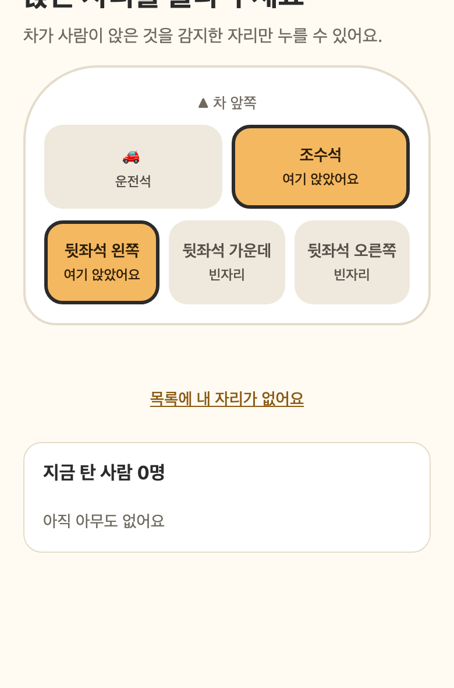
  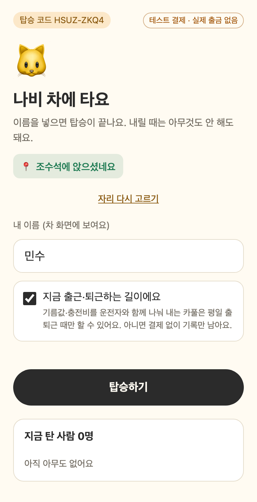
  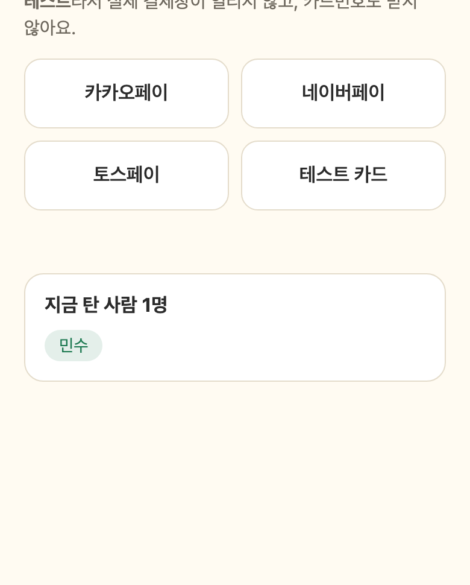
  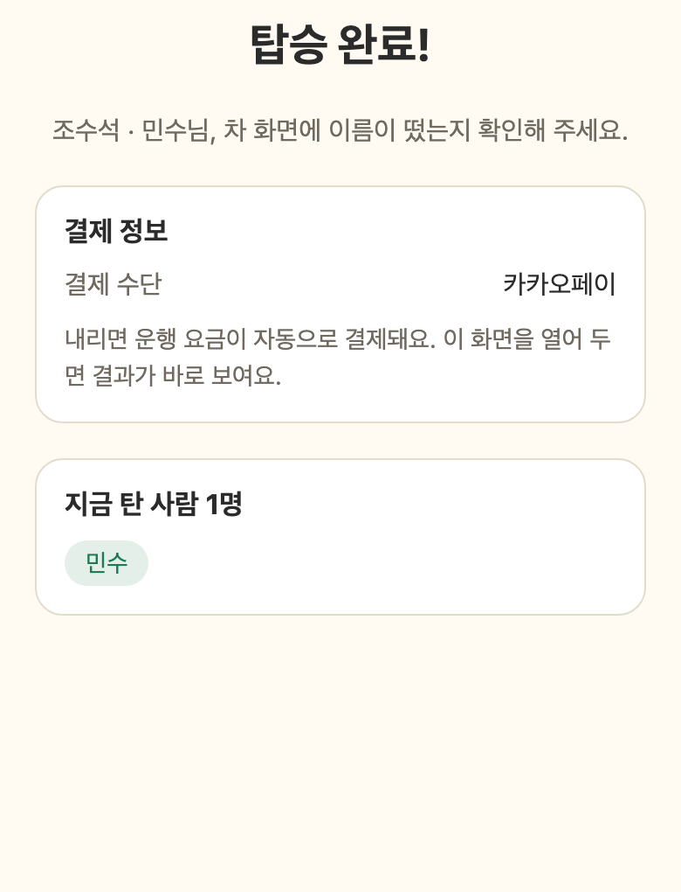
</p>

### 4. 주행 중: 냥 숫자만

달리는 동안에는 고양이·QR·입력 화면을 숨기고 냥 숫자와 탑승자 목록만 남깁니다. 냥은 택시 미터기처럼 한 칸씩 오릅니다(100m마다 10냥, 1분마다 10냥). 그 아래에 지금까지 든 실비와 1인당 금액이 보입니다.

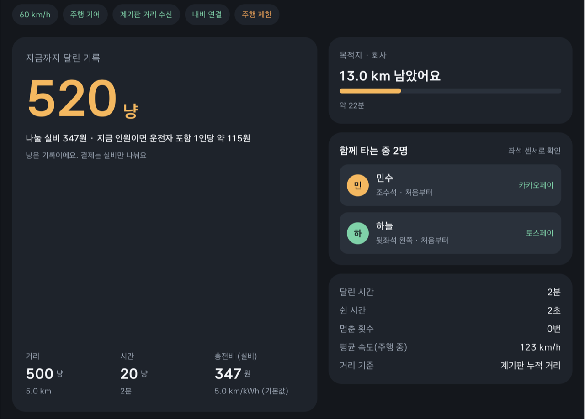

### 5. 중간 탑승: 그 자리의 QR

이동 중에 차를 세우고 누가 앉으면 그 자리의 QR("뒷좌석 오른쪽 탑승 QR")이 뜹니다. 탄 지점이 기록되어 **탄 뒤 구간만** 나눠 냅니다. 차가 움직이면 QR 화면은 닫힙니다.

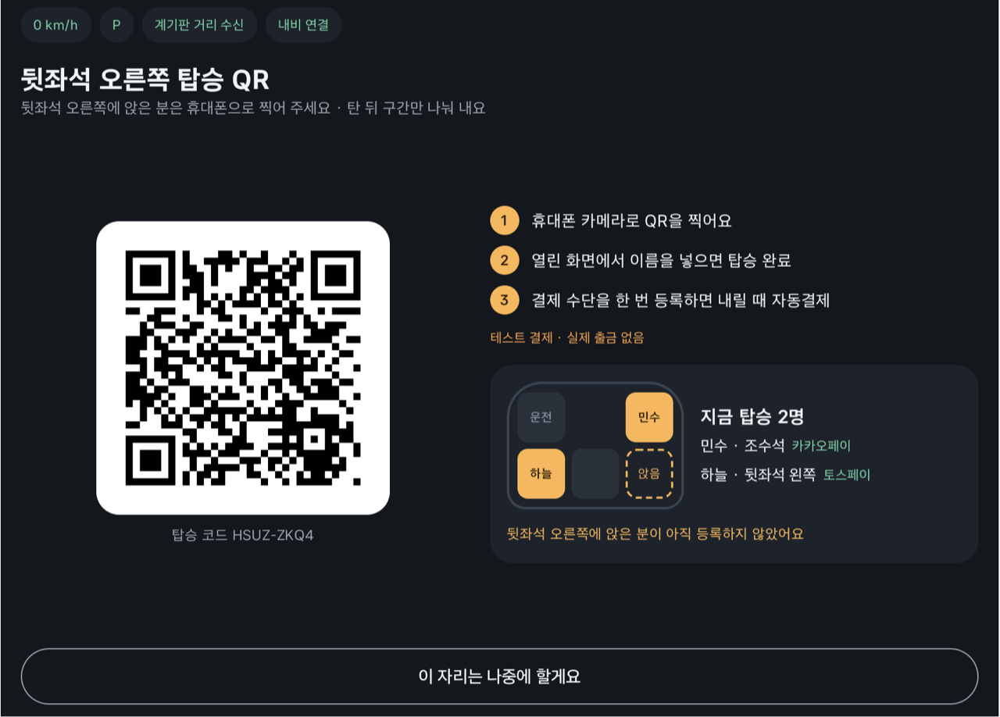

### 6. 중간 하차: 자리가 비고 문이 열리면

차가 서 있는 동안 자리가 비고 그 자리 쪽 문이 열리면 "하차 확인 중"으로 표시합니다. 그대로 30초가 지나거나, 빈 채로 출발해 5초가 지나면 하차로 확정합니다. 문을 열지 않고 자리만 비면 하차로 보지 않습니다. 정차 중에는 고양이가 다시 나옵니다.

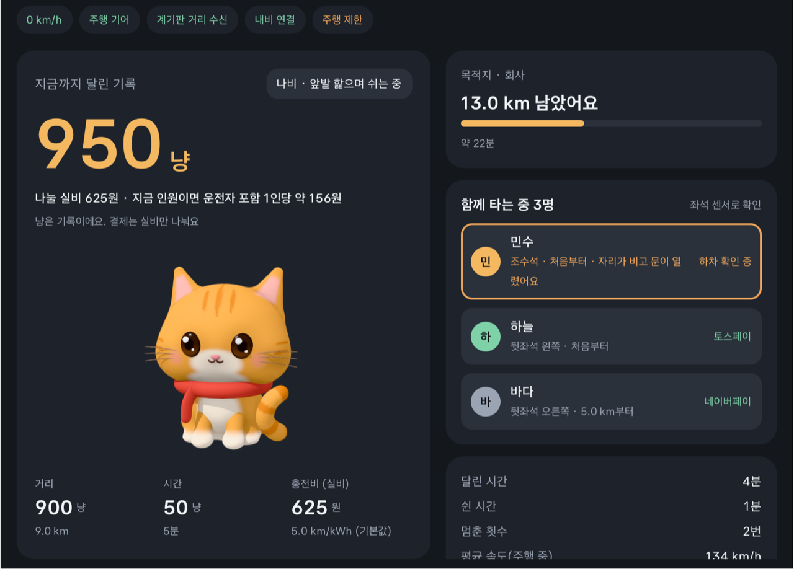

하차가 확정되면 승객 휴대폰에 "하차 처리됐어요"와 **[아직 타고 있어요]**가 뜨고, 60초 뒤 그 사람이 탄 구간의 몫만 정산합니다. 민수는 0~9km 구간의 몫 185원을 냈습니다.

<p>
  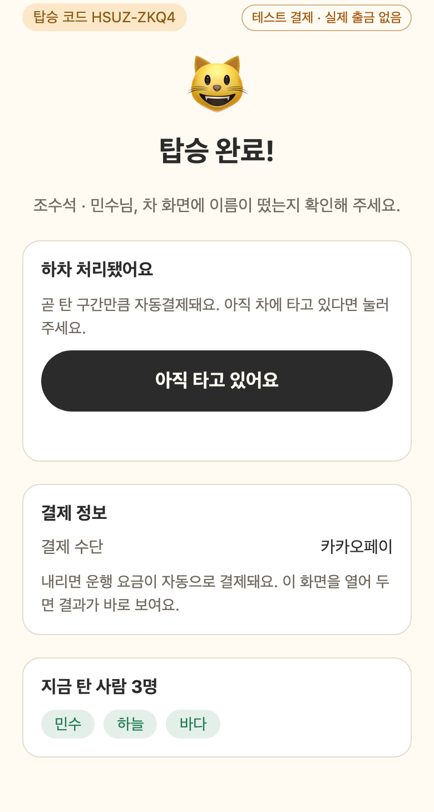
  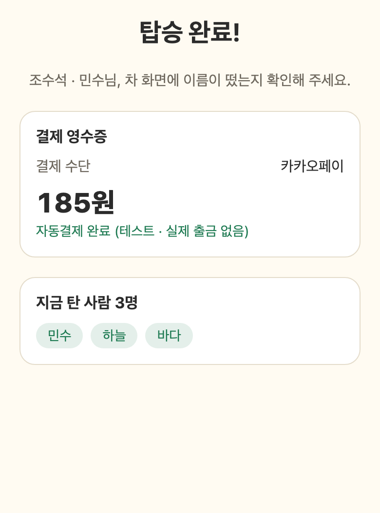
</p>

### 7. 도착: 자동 정산과 냥수증

P단을 넣으면 "도착했나요?"를 묻고, 도착하면 남은 사람의 몫이 자동으로 정산됩니다. 먼저 내린 사람은 다시 정산하지 않습니다. 맨 위 그림이 이 화면입니다.

| 사람 | 탄 구간 | 낸 돈 |
|---|---|---|
| 민수 (먼저 내림) | 0 → 9 km | 185원 |
| 하늘 | 0 → 13 km | 277원 |
| 바다 (중간 탑승) | 5 → 13 km | 161원 |
| 운전자 | 전 구간 | 279원 (충전비 902원에서 받은 623원을 뺀 나머지) |

## 주요 기능

상태 표시는 기획서와 같습니다. **구현**은 코드에 있고 단위 테스트를 통과한 것, **계획**은 아직 만들지 않은 것입니다.

| 기능 | 내용 | 쓰는 차량 데이터 | 상태 |
|---|---|---|---|
| 오늘의 고양이 | 출발 전 이름·털 색(4종)·소품(4종)을 고르는 3D 고양이. 이동 횟수가 쌓인다 | 정차 중에만 표시 | 구현 |
| 앉으면 뜨는 자리별 QR | 동승석에 새로 앉으면 정차 중에 그 자리 탑승 QR이 자동으로 뜨고, 등록이 끝나면 닫힌다 | 좌석 점유·안전벨트, 주행 제한 상태 | 구현 (탑승 등록은 웹 화면. 승객용 앱은 계획) |
| 함께 탈 때 자리 고르기 | 두 명 이상이 함께 앉으면 QR 하나만 띄우고, 휴대폰의 좌석 배치도에서 앉은 자리를 고른다 | 좌석 센서로 본 앉은 자리 | 구현 |
| 중간 탑승 | 이동 중 정차해서 누가 앉으면 그 자리 QR이 뜨고 탄 지점을 기록한다 | 좌석 센서, 주행 제한 상태, 계기판 거리 | 구현 |
| 하차 판단 | 정차 중 자리가 비고 그 자리 쪽 문이 열리면 하차로 본다 (30초 유지 또는 출발 후 5초) | 좌석 점유·안전벨트, 문 열림, 차속 | 구현 (에뮬레이터에서 확인) |
| 실비 계산 | 달린 거리 ÷ 연비·전비 × 단가. 나눌 금액은 이 실비뿐이다 | 계기판 누적 거리, 연비·전비 | 구현 (주유비·충전비 + 내비 경로 통행료) |
| 냥 미터 | 100m마다 10냥, 1분마다 10냥. 함께 달린 기록이며 돈이 아니다 | 계기판 누적 거리 | 구현 |
| 운전자 포함 구간별 나누기 | 탑승·하차 시점마다 구간을 나누고, 각 구간의 실비를 그때 타고 있던 사람과 운전자가 똑같이 나눈다 | 탑승·하차 지점의 실제 거리 | 구현 |
| 내리면 그 사람만 정산 | 하차가 확정되면 1분 뒤 그 사람이 탄 구간의 몫만 정산한다. 승객이 [아직 타고 있어요]로 취소할 수 있다 | 하차 지점의 실제 거리 | 구현 (테스트 결제) |
| 도착하면 자동 정산 | 결제 수단을 한 번 등록하면 도착 후 남은 사람의 몫이 자동으로 정산된다 | P단, 내비 안내 종료 | 구현 (테스트 결제) |
| 출퇴근 판정 (운전자) | 평일 출퇴근 시간대 + 내비의 집↔회사 이동 + 시간대당 1회일 때만 정산한다 | 내비 즐겨찾기, 출발·도착 위치 | 구현. 돌아간 거리 상한은 계획 |
| 출퇴근 판정 (동승자) | 탈 때 "출퇴근 길"인지 직접 고른다. 아니라고 고른 사람은 나누는 인원에서 뺀다 | 탑승·하차 위치 | 탈 때 고르기는 구현. 직장 메일 인증과 내린 뒤 경로 확인은 계획 |
| 냥수증 | 고양이, 목적지, 시간, 거리, 냥, 실비, 함께 탄 사람을 담은 영수증. 이미지 저장·공유 | – | 구현 |
| 내비 연동 | 목적지를 찍으면 예상 실비와 정산 가능 여부를 미리 보여 준다 | NaviHelper 목적지·경로 | 구현 |
| 통행료 나누기 | 요금소를 지날 때 타고 있던 사람과 운전자가 똑같이 나눈다. 출발 전 예상 실비에는 경로 전체 통행료를 넣는다 | 내비 경로 통행료(`RouteStartInfo.tollFare`), 회전 안내의 요금소(`TURN_TOLL`), 계기판 거리 | 구현 (에뮬레이터에서 확인). 요금소별 금액은 내비가 주지 않아 남은 통행료를 남은 요금소 수로 똑같이 나눈다. 운전자가 실제 금액으로 고치는 기능은 계획 |
| 하차·정산 안내 음성 | 하차가 확정됐을 때와 도착해 정산됐을 때 한 문장으로 읽어 준다 | Pleos TextToSpeech (온디바이스) | 구현 (에뮬레이터에서 초기화와 재생 호출 확인) |
| 승객용 휴대폰 앱 | 직장 메일 인증, 집·직장 등록, 앱 안 QR 스캔, 결제 수단 저장, 푸시 알림 | – | 계획. 지금은 QR로 열리는 웹 화면 |

## 금액을 나누는 방법

- **실비만 나눕니다.** 주유비·충전비 = 달린 거리 ÷ 연비(전비) × 단가. 운전 대가는 받지 않습니다.
- **운전자도 한 사람으로 셉니다.** 탑승·하차 시점마다 구간을 나누고, 각 구간의 실비를 그 구간에 타고 있던 사람과 운전자가 똑같이 나눕니다.
- 아무도 타지 않은 구간은 운전자 몫입니다.
- 동승자 금액은 원 아래를 버리고, 남는 끝전은 운전자가 냅니다. 동승자가 낸 합계가 실비를 넘지 않게 하려는 것입니다.
- 먼저 내린 사람의 금액은 그 뒤에 누가 타고 내리든 바뀌지 않습니다.
- 탈 때 "출퇴근 길이 아니에요"를 고른 사람은 나누는 인원에서 빼고, 돈을 받지 않습니다.
- 탑승 QR 없이 운전자가 이름만 넣은 사람은 인원에 넣고 금액만 보여 줍니다 (자동 정산 없음).
- 연비·전비는 Pleos `Fuel`·`EvBattery`의 누적 평균을 쓰고, 받지 못하면 기본값(전기 5.0 km/kWh·347원/kWh, 휘발유 12 km/L·1,700원/L)을 씁니다.
- 냥(100m마다 10냥, 1분마다 10냥)은 정산에 들어가지 않고 냥수증에 기록으로만 남습니다.

기획서의 대표 시나리오(편도 25km, 휘발유 12km/L·1,700원/L, 주유비 3,542원)로 계산하면 이렇습니다.

| 구간 | 타고 있던 사람 | 구간 주유비 | 1인 몫 |
|---|---|---|---|
| 0~8km | 지수(운전), 민수, 하늘 | 1,133원 | 378원 |
| 8~18km | 지수, 민수, 하늘, 바다 | 1,417원 | 354원 |
| 18~25km | 지수, 하늘, 바다 | 992원 | 331원 |

| 사람 | 탄 구간 | 내는 돈 |
|---|---|---|
| 민수 | 0~18km | 731원 |
| 하늘 | 0~25km | 1,062원 |
| 바다 | 8~25km | 684원 |
| 지수 (운전자) | 전 구간 | 1,065원 |

계산 코드는 `trip/TripBill.kt`(`TripBill.split`)에 있습니다.

## 언제 정산이 켜지나

여객자동차 운수사업법 제81조는 자가용 유상운송을 금지하고, 운행에 필요한 경비를 받는 것도 유상으로 봅니다. 평일 출퇴근 시간대에 승용차를 함께 타는 경우만 예외입니다. 그래서 실비만 나눠도 조건을 통과한 운행에서만 정산을 켜고, 그 밖의 이동에서는 냥만 보여 주고 이유를 알려 줍니다.

- 평일(토·일·공휴일 제외) 오전 7~9시, 오후 6~8시에 출발과 도착이 모두 들어 있을 것
- 내비 즐겨찾기의 집 ↔ 회사(반경 1km) 사이를 이동했을 것
- 같은 시간대에 아직 정산하지 않았을 것
- 먼저 내린 사람은 출발 시각·출발지·내비 목적지로 미리 판정해, 맞을 때만 그 자리에서 정산합니다. 아니면 도착 때 함께 정산합니다.
- 시각은 기기 시간대와 관계없이 한국 시간으로 판정합니다. 공휴일은 2026~2027년 목록을 앱에 넣어 두었습니다(임시공휴일은 수동 추가). 코드는 `trip/CommuteRule.kt`에 있습니다.

법률 자문을 받은 것은 아닙니다. 보험은 개인용 자동차보험 표준약관이 같은 시간대·경로의 출퇴근 함께타기를 유상운송 면책의 예외로 두는 것을 약관에서 확인했지만, 실제 보상 여부는 가입한 보험사의 판단에 따릅니다. 자세한 내용과 출처는 기획서 2번 "법적 배경"에 있습니다.

## 안전 설계

- 주행 중에는 고양이·QR·입력 화면을 숨기고 냥 숫자만 남깁니다. 모든 조작은 정차(주행 제한 해제) 중에만 합니다. 고양이는 움직이지 않는 정지 그림입니다.
- 하차는 차가 서 있는 동안 자리가 비고 문이 열렸을 때만 판단합니다. 하차 확정이 곧 정산이라서, 잘못 판단하지 않도록 두 신호를 함께 봅니다.
- 정산 알림은 승객 휴대폰으로만 가고, 차량 화면에는 결제 화면을 띄우지 않습니다.
- 차량 제어 API는 쓰지 않습니다. 값을 읽기만 합니다.

## 사용한 차량 데이터

| 데이터 | 경로 | 권한 |
|---|---|---|
| 차속 | AAOS `CarPropertyManager` `PERF_VEHICLE_SPEED` (Vehicle SDK 2.3.2에는 차속 API 없음) | `android.car.permission.CAR_SPEED` (런타임 요청) |
| 주행 제한 상태 | AAOS `CarUxRestrictionsManager` | 없음 |
| 누적 주행 거리 | Pleos Vehicle `Odometer.getCurrentDistanceDriven` / `registerDistanceDriven` | `pleos.car.permission.CAR_DRIVE` |
| 기어(P 판단) | Pleos Vehicle `Gear.getCurrentGearSelectionState` / `registerGearSelection` | `pleos.car.permission.CAR_DRIVE` |
| 전비·연비 | Pleos Vehicle `EvBattery.getCumulativeEvEfficiency` / `Fuel.getCumulativeFuelEconomy` | `pleos.car.permission.CAR_ENERGY` |
| 목적지·집·회사·현재 위치 | Pleos NaviHelper `getDestinationInfo` / `onRouteStarted` / `getBookmarkInfo`(HOME·OFFICE) / `getCurrentLocationInfo` | `pleos.car.permission.NAVI_ROUTE` |
| 좌석 점유·안전벨트 착용 | Pleos Vehicle `Seat.registerSeatOccupancy` / `registerSeatBeltBuckledState` | `pleos.car.permission.CAR_SEATS` |
| 문 열림 | Pleos Vehicle `Door.checkDoorPositionCapabilities` / `registerDoorPosition` | `pleos.car.permission.CAR_DOORS` |
| 경로 통행료·요금소 | Pleos NaviHelper `onRouteStarted`(`RouteStartInfo.tollFare`) / `getTBTInfo`(`TURN_TOLL`) | `pleos.car.permission.NAVI_ROUTE` |
| 안내 음성 | Pleos TextToSpeech `Mode.ON_DEVICE`, `speak` (앱 등록 없이 사용) | `pleos.car.permission.TTS_SERVICE` |

**에뮬레이터에서 확인한 것 (Pleos Connect 에뮬레이터 v2.1.0)**

- 지원 좌석은 조수석과 2열 좌·중·우입니다. 좌석 점유 변경 알림은 1초 안에 들어옵니다.
- Virtual Console의 좌석 점유와 SDK 값이 반대로 들어와 debug 빌드에서만 값을 뒤집습니다(`SEAT_OCCUPANCY_INVERTED`). 실차 값 방향은 확인이 필요합니다.
- 알림을 등록하는 순간 값이 잠깐 흔들려, 좌석 신호가 1.5초 동안 그대로일 때만 판단합니다.
- Virtual Console에서 안전벨트 착용은 바꿀 수 없어 좌석 점유로 시험했습니다.
- 문 열림 신호는 1열 오른쪽, 2열 왼쪽, 2열 오른쪽 문에서 들어옵니다. 차가 그 자리 쪽 문 신호를 주지 않으면 좌석 신호만으로 판단합니다.
- 통행료 (2026-11-14 확인)
  - 경로 통행료는 **경로를 시작할 때만** 들어옵니다 (`RouteStartInfo.tollFare`, 인천공항 경로에서 4,700원). `DestinationInfo.tollFare`는 같은 경로에서도 0 으로 옵니다. SDK 설명으로는 둘 다 남은 통행료가 아니라 경로 전체 통행료입니다.
  - 그래서 앱을 경로 안내 도중에 다시 켜면 통행료를 알 수 없습니다.
  - 회전 안내 목록(`getTBTInfo`)에 요금소(`TURN_TOLL`)가 순서대로 들어 있고, 거리는 앞 안내에서 그 안내까지의 구간 길이입니다. 앞 구간을 더해 요금소까지의 거리를 구합니다.
  - 에뮬레이터에서는 차속을 올려도 내비의 위치와 남은 거리가 바뀌지 않습니다. 그래서 요금소 통과는 달린 거리(계기판·차속)로 판단하고, 내비 목록이 바뀌면 그에 맞춥니다.
  - 할인(경차·출퇴근 할인 등)이 반영된 값인지는 확인하지 못했습니다.
- 연비·전비 (2026-11-14 확인): 에뮬레이터 차량은 `getCumulativeEvEfficiency`·`getCurrentEvEfficiency`·`getCumulativeFuelEconomy`·`getCurrentFuelEconomy` 네 속성을 모두 지원하지 않습니다 (`ERROR_NOT_SUPPORTED_PROPERTY`). 그래서 전기차 기본값(5.0 km/kWh, 347원/kWh)으로 계산합니다. 차량 값이 들어오고 범위(전기 1~15 km/kWh, 연료 3~40 km/L) 안이면 그 값을 씁니다.
- 안내 음성 (2026-11-14 확인): Pleos TextToSpeech SDK 3.3.1 을 온디바이스 모드로 쓰면 앱 등록 없이 초기화되고 `speak` 호출이 오류 없이 끝납니다. 권한 `pleos.car.permission.TTS_SERVICE`가 필요합니다. 소리가 실제로 났는지는 로그로 확인할 수 없어 귀로 들어 봐야 합니다.
- 누적 거리는 Virtual Console에서 값을 넣기 전까지 `0.0`으로 고정돼 있습니다. 값이 멈춰 있으면 차속을 시간에 대해 적분해 추정하고, 어느 기준을 썼는지 화면에 표시합니다.
- 에뮬레이터 차량은 연비·전비 속성을 지원하지 않아(`ERROR_NOT_SUPPORTED_PROPERTY`) 전기차 기본값이 쓰입니다.

## 실행

### 빌드된 APK 내려받기

빌드된 APK는 저장소에 넣지 않고 [GitHub Releases](https://github.com/hyndai-contest-team/cat-meter/releases)에 올립니다.

- [냥미터기 0.1.0-mvp (디버그 빌드)](https://github.com/hyndai-contest-team/cat-meter/releases/tag/v0.1.0-mvp): Pleos Connect 에뮬레이터 v2.1.0 용
- 설치: `adb install -r cat-meter-0.1.0-mvp-debug.apk`
- 디버그 빌드라 좌석 점유 값을 에뮬레이터 방향에 맞춰 뒤집어 읽고, 탑승 서버 주소는 `http://10.0.2.2:8787`입니다. 탑승 QR과 자동결제를 쓰려면 같은 컴퓨터에서 아래 탑승 등록 서버를 켜야 합니다.
- 새로 만들려면 `./gradlew :app:assembleDebug`를 실행합니다. 결과는 `app/build/outputs/apk/debug/app-debug.apk`에 생깁니다.

### 개발 환경

- Kotlin + Jetpack Compose, minSdk 28, Pleos Connect 에뮬레이터(system-image `android-34/pleos_car_emulator`)
- 3D 고양이: 코드로 만든 GLB 모델(`tools/make_cat_glb.py`)을 Filament로 렌더링
- 탑승 등록 서버: Node.js 20 이상, 외부 라이브러리 없음
- JDK는 Android Studio 내장 JBR을 씁니다. 터미널에서 빌드하려면 `JAVA_HOME="/Applications/Android Studio.app/Contents/jbr/Contents/Home"`을 지정합니다.

### 한 번에 실행 (에뮬레이터 + Virtual Console)

```bash
./scripts/run-emulator.sh            # 에뮬레이터 켜기 → 부팅 대기 → Virtual Console 브라우저로 열기
./scripts/run-emulator.sh --install  # 위에 더해 앱 빌드·설치까지
```

스크립트가 하는 일:
1. AVD `Pleos_Connect_v2.1.0`을 **Cold boot**(`-no-snapshot-load`)로 켭니다. Quick boot로 켜면 VHAL을 쓸 수 없습니다. 이미 켜진 에뮬레이터가 있으면 그것을 씁니다.
2. 부팅이 끝날 때까지 기다립니다 (`sys.boot_completed`, 최대 5분).
3. `--install`을 주면 `./gradlew installDebug`를 실행합니다.
4. `adb forward tcp:8088 tcp:8088`으로 포트를 연결하고, `http://127.0.0.1:8088/`(Virtual Console)을 기본 브라우저로 엽니다.

바꿀 수 있는 값: `AVD_NAME`(에뮬레이터 이름), `ANDROID_HOME`(SDK 경로, 기본 `~/Library/Android/sdk`), `JAVA_HOME`. 에뮬레이터 로그는 `$TMPDIR/catmeter-emulator.log`에 남습니다.

Virtual Console이 열리지 않으면 `adb devices`로 에뮬레이터가 보이는지 확인하고 `adb forward tcp:8088 tcp:8088`을 다시 실행합니다. (근거: Pleos 문서 [Virtual Console Setup Guide](https://document.pleos.ai/en/docs/connect/guide/getting-started/application-development/use-vehicle-emulator), [Configuring Emulator](https://document.pleos.ai/en/docs/connect/guide/getting-started/application-development/configure-pleos-connect-emulator))

### 탑승 등록 서버

탑승 QR은 이 서버의 휴대폰용 주소를 담습니다. 서버가 떠 있어야 QR로 탈 수 있습니다.

```bash
cd server
npm start   # 또는 node src/server.mjs
npm test    # 서버 테스트
```

- 서버는 `8787` 포트로 뜨고, 시작할 때 휴대폰이 열 주소(이 컴퓨터의 와이파이 IP)를 출력합니다. **휴대폰과 컴퓨터가 같은 와이파이**에 있어야 합니다.
- 에뮬레이터 앱은 `http://10.0.2.2:8787`로 접속합니다. 다른 서버를 쓰려면 `./gradlew installDebug -PboardingServerUrl=https://...`로 빌드합니다.
- 환경 변수: `PORT`(기본 8787), `PUBLIC_URL`(휴대폰이 열 주소. 비우면 와이파이 IP로 만듭니다).
- 탑승 정보는 서버 메모리에만 두고 3시간이 지나면 지웁니다. 서버를 끄면 사라집니다. 받는 개인정보는 탑승자 이름뿐입니다.
- 결제는 테스트입니다. 실제 결제창은 열리지 않고 카드번호도 받지 않습니다. 서버는 `mock_`으로 시작하는 가짜 빌링키만 저장합니다. 같은 이동은 두 번 결제하지 않습니다.
- debug 빌드만 `10.0.2.2`·`localhost`로 http 통신을 허용합니다. 실차·release는 https 서버가 필요합니다.
- 서버에 연결하지 못하면 QR 대신 "탑승 서버에 연결할 수 없어요"와 **다시 연결** 버튼을 보여 주고, 이름은 직접 넣을 수 있습니다.

| 주소 | 누가 | 하는 일 |
|---|---|---|
| `PUT /api/rides/:code` | 차량 앱 | 이동을 열고 휴대폰용 주소(`joinUrl`)와 차량 토큰을 받음 |
| `GET /api/rides/:code` | 차량 앱 | 탑승자 목록과 좌석 상태 |
| `PUT /api/rides/:code/seats` | 차량 앱 | 좌석 상태가 바뀔 때마다 알림 |
| `POST /api/rides/:code/alights` | 차량 앱 | 하차 확정 알림 |
| `POST /api/rides/:code/charges` | 차량 앱 | 자동결제 (테스트). `Authorization: Bearer <차량 토큰>` 필요 |
| `GET /ride/:code` | 승객 휴대폰 | 탑승 등록 페이지 |
| `POST /api/rides/:code/passengers` | 승객 휴대폰 | 이름·출퇴근 여부를 넣어 탑승 (최대 7명, 이름 1~10자, 같은 이름 불가) |
| `POST /api/rides/:code/passengers/:id/payment` | 승객 휴대폰 | 테스트 결제 수단 등록 (출퇴근 길인 사람만) |
| `POST /api/rides/:code/passengers/:id/seat` | 승객 휴대폰 | 자리 고르기·자리 이동 |
| `POST /api/rides/:code/passengers/:id/stay` | 승객 휴대폰 | [아직 타고 있어요] 하차 취소 |
| `GET /api/rides/:code/passengers/:id` | 승객 휴대폰 | 내 탑승 정보와 결제 결과 |

### 에뮬레이터에서 시연하기

주행 값은 **Pleos Connect Virtual Console**에서 넣습니다. 이 에뮬레이터는 user 빌드라 `adb shell cmd car_service inject-vhal-event`를 쓸 수 없습니다.

| 영역 | 카드 | 이 앱에서 쓰는 곳 |
|---|---|---|
| Motion | Gear Selection (P·R·N·D), Odometer | 도착 확인(P단), 주행 제한 해제, 누적 거리 |
| Convenience | Seat Occupancy (조수석·뒷좌석 좌우) | 탑승 QR, 중간 하차 판단 |
| Convenience | Door Position (앞·뒤 좌우) | 중간 하차 판단 |

- 탑승 QR과 입력 화면은 주행 제한이 풀렸을 때만 뜹니다. 에뮬레이터에서는 기어를 P에 두어야 풀립니다.
- 차속은 기어 D에서 가속 페달 값으로 바뀝니다.
- 분할 화면은 화면 오른쪽 끝의 `⋮` 핸들을 왼쪽으로 끌어서 엽니다. 좁은 창에서는 냥 숫자 중심, 넓은 창에서는 상세 내역을 보여 줍니다.

**시연용 출퇴근 판정 (debug 빌드만).** 자동 정산은 평일 출퇴근 시간대에 집↔회사를 이동한 운행에서만 켜집니다. 다른 시간에 시연하려면 아래 명령으로 판정을 켭니다. 앱을 다시 시작하면 꺼집니다.

```bash
adb shell am broadcast --user current -a kr.catmeter.app.DEBUG_ROUTE -n kr.catmeter.app/.DebugRouteReceiver --ez demoCommute true
```

내비 목적지를 명령으로 넣을 수도 있습니다 (debug 빌드만).

```bash
adb shell am broadcast --user current -a kr.catmeter.app.DEBUG_ROUTE -n kr.catmeter.app/.DebugRouteReceiver --ed lat 37.4979 --ed lon 127.0276 --es name 회사
```

### 테스트

```bash
./gradlew testDebugUnitTest   # 앱 단위 테스트
cd server && npm test         # 서버 테스트
```

2026-11-14 기준 앱 단위 테스트 60개, 서버 테스트 17개가 모두 통과합니다.

## 구조

```
app/src/main/java/kr/catmeter/app/
  CatMeterSession.kt        앱 프로세스 단위 이동 세션 (창 전환·분할 화면 변경에도 기록 유지)
  trip/TripTracker.kt       이동 기록 계산 (순수 Kotlin)
  trip/TripBill.kt          실비 계산, 운전자 포함 구간별 나누기
  trip/NyangFare.kt         거리·시간 → 냥
  trip/CommuteRule.kt       출퇴근 함께 타기 판정
  trip/AlightTracker.kt     자리 비움 + 문 열림으로 하차 판단
  trip/Seats.kt             좌석 위치
  trip/Boarding.kt          탑승 코드
  trip/Models.kt            고양이·소품·이동 기록 모델
  car/AaosMonitor.kt        차속, 주행 제한 상태 (AAOS Car API)
  car/PleosVehicleSource.kt 누적 거리, 기어, 연비·전비 (Pleos Vehicle SDK)
  car/SeatSensor.kt         좌석 점유·안전벨트
  car/DoorSensor.kt         문 열림
  car/NaviSource.kt         내비 목적지·집·회사 (Pleos NaviHelper)
  data/BoardingClient.kt    탑승 등록 서버와 통신
  data/CatMeterStore.kt     설정·동승자·기록을 기기 안에만 저장
  ui/SetupScreen.kt         출발 전
  ui/BoardingQrScreen.kt    탑승 QR
  ui/DriveScreen.kt         이동 중 (좁은 창·넓은 창)
  ui/ReceiptScreen.kt       냥수증
  ui/SettlePanel.kt         도착 후 사람별 정산 결과
  ui/cat3d/                 3D 고양이 (Filament)
server/                     탑승 등록 서버 (src/app.mjs 요청 처리, src/store.mjs 저장소, public/ride.html 휴대폰 페이지)
scripts/run-emulator.sh     에뮬레이터 + Virtual Console 한 번에 실행
tools/make_cat_glb.py       고양이 GLB 모델 생성
docs/                       기획서, 기획 문서, 회의록, 화면 캡처
```

## 한계와 남은 일

**하차 판단의 알려진 한계** (잘못 판단하면 승객이 [아직 타고 있어요]로 취소합니다)

- 뒷좌석 가운데와 3열은 양쪽 2열 문 중 어느 쪽이 열려도 문 조건이 채워집니다.
- 정차 중 다른 자리로 옮겨 앉고 그쪽 문이 열렸으면, 원래 자리가 하차로 판단됩니다.
- 자기 자리 쪽이 아닌 반대쪽 문으로 내리면 하차를 놓칩니다. 이때는 도착할 때 함께 정산됩니다.
- 벨트만 있는 자리(좌석 점유 센서 없음)는 30초로는 확정하지 않고, 벨트를 푼 채 출발해 5초가 지나야 확정합니다.

**아직 확인하지 못한 것**

- 실차에서의 좌석 점유 값 방향, 뒷좌석 센서 지원 여부, 문 열림 신호.
- 내비가 주는 거리·시간의 단위(m·초로 가정), 통행료에 할인이 반영되는지, 실차에서 `DestinationInfo.tollFare`가 채워지는지.
- 앱 프로세스가 종료되면 진행 중인 기록은 사라집니다.

**아직 만들지 않은 것** (기획서 5번 개발 단계)

- 통행료를 운전자가 실제 하이패스 금액으로 고치기, 내비 안내 없이 달린 이동의 통행료 입력, 돌아간 거리 상한, 돌아간 거리 기름값 나누기
- 승객용 휴대폰 앱: 직장 메일 인증, 집·직장 등록, 내린 뒤 경로 확인. 탑승 등록 웹은 없앨 예정입니다.
- 실제 결제(결제대행사 연동), https 서버, 운전자 자동차보험 가입 확인

**풀지 못하는 것**

- 출퇴근 시간대(평일 오전 7~9시, 오후 6~8시) 밖의 이동은 정산하지 않습니다. 법이 허용한 범위가 여기까지입니다.
- 출퇴근 시간을 서로 맞추는 불편과 돌아가느라 쓰는 시간은 풀지 못합니다. 시간을 돈으로 갚으면 운전 대가가 되기 때문입니다. 냥미터기가 푸는 것은 돈 부분입니다.

## 문서

- 기획서: [`docs/application/2026_11_10_app_intro.md`](docs/application/2026_11_10_app_intro.md) — 기획 배경, 기능, 시나리오, 개발 계획, 타깃·예상 MAU·수익 모델·확대 계획
- 기획서 근거 초안: [`docs/application/2026_11_14_app_intro_pain_points_draft.md`](docs/application/2026_11_14_app_intro_pain_points_draft.md) — 근거 글 목록, 구독료 계산, 보험 약관 조사
- 기획 문서: [`docs/ideas/`](docs/ideas/) — 결제 흐름, 결제 방식 단계, 통행료 나누기
- 회의록: [`docs/meetings/`](docs/meetings/)
- 고양이 모델 사양: [`docs/spec/cat-model-spec.md`](docs/spec/cat-model-spec.md)
